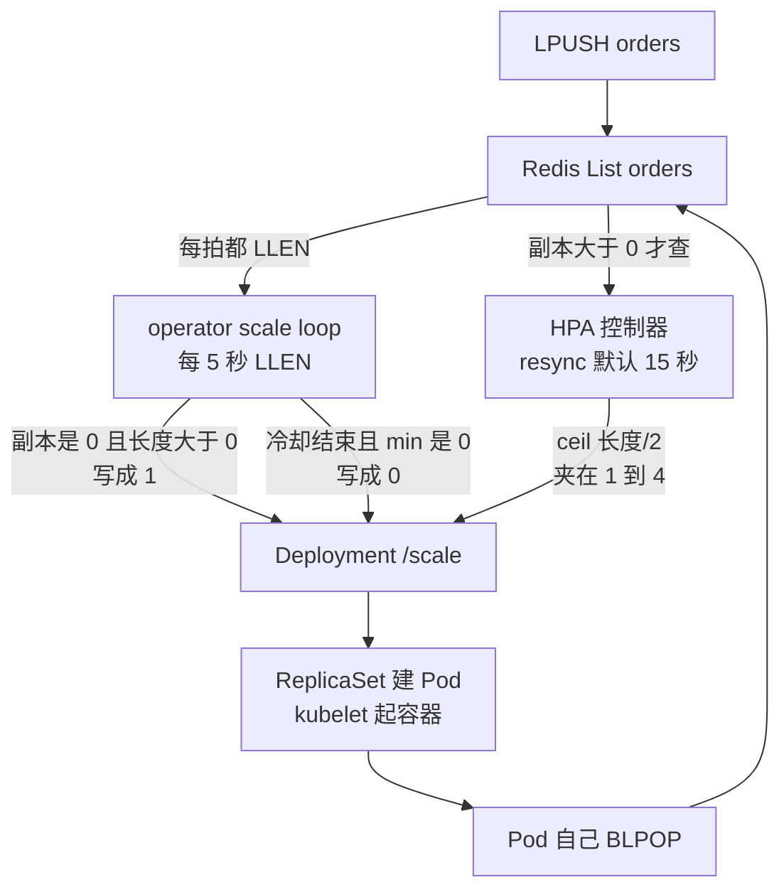
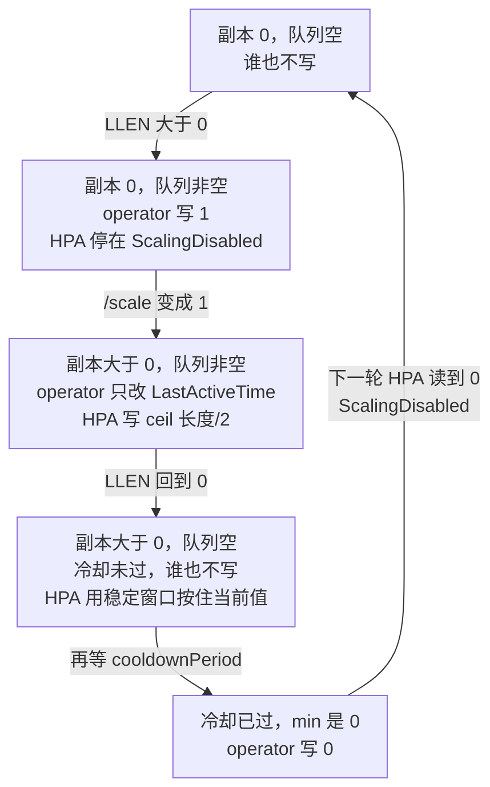
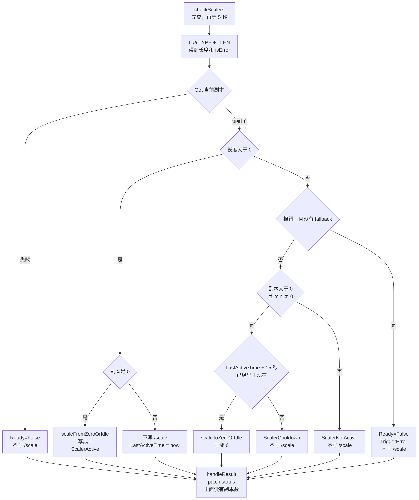
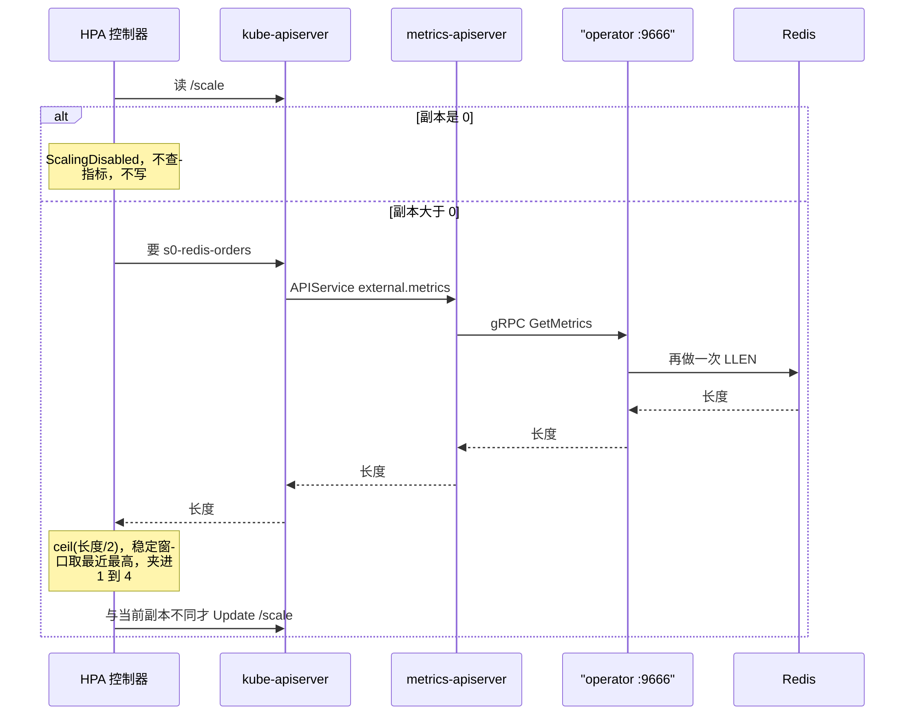
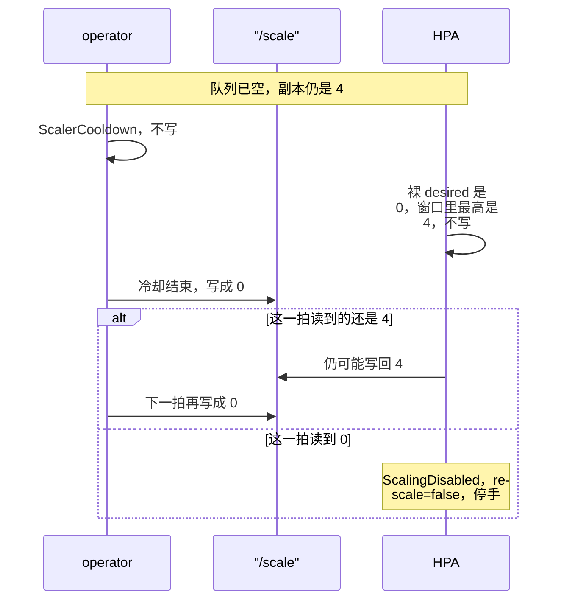
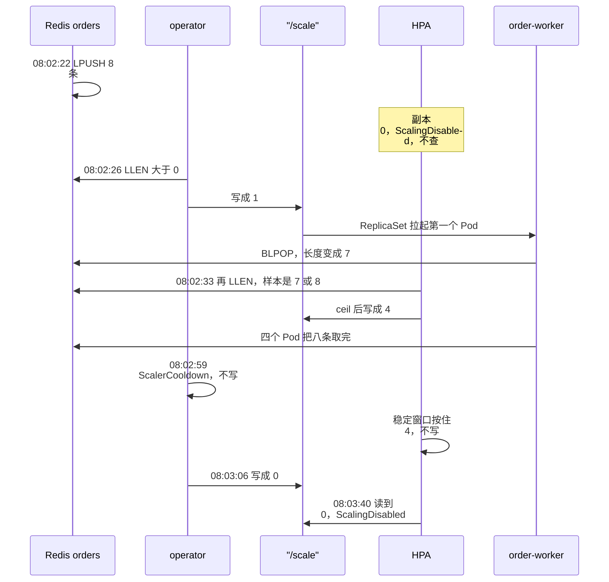

# KEDA 怎样工作

2026-10-10 08:02:22，8 笔订单 `LPUSH` 进 Redis List `orders`。44 秒里 Deployment `order-worker` 的 `/scale` 被改了三次：0 写成 1，1 写成 4，4 写成 0。写这三次的不是同一个进程。

`keda-operator` 只在副本越过 0 的时候改数字。1 到 N 由 kube-controller-manager 里的 HPA 控制器算。两边写的是同一个 scale 子资源。订单正文不进 KEDA，消费者自己 `BLPOP`。

对照 KEDA tag `v2.21.0`，commit `626ded5d783`，检出在 `/tmp/keda-v2.21.0`。HPA 对照 `/Users/xiaoxia/Projects/learning/kubernetes`，commit `f322464da46`。集群是 kind `k8s-lab`，服务端 v1.36.1。安装和这次的清单在 [README](./README.md)。组件图在第 8 节，本文写决策顺序。

## 目录

1. [坐标系](#1-坐标系)
2. [一次轮询的顺序](#2-一次轮询的顺序)
3. [越过 0：operator 写 1](#3-越过-0operator-写-1)
4. [1 到 N：HPA 再写同一个 scale](#4-1-到-nhpa-再写同一个-scale)
5. [回到 0：冷却、稳定窗口、HPA 停手](#5-回到-0冷却稳定窗口hpa-停手)
6. [这 8 笔订单对上哪一拍](#6-这-8-笔订单对上哪一拍)
7. [轮询开始之前](#7-轮询开始之前)
8. [三个进程](#8-三个进程)
9. [边界](#9-边界)
10. [源码索引](#10-源码索引)
11. [观察命令](#11-观察命令)

## 1. 坐标系

一条订单从 `LPUSH` 到 Pod 起来，经过四段。只有中间两段会写副本。

| 段 | 进程 | 周期 | 这次它干什么 |
|---|---|---|---|
| 事件源 | Redis 容器 `keda-redis` | 无 | List `orders`。KEDA 只读长度 |
| 0 的边界 | `keda-operator` 的 scale loop | `pollingInterval`，这次 5 秒 | `LLEN`。副本是 0 且队列非空就写成 1。冷却结束后写成 0 |
| 1 到 N | HPA 控制器 | 自己的队列，默认同步 15 秒 | 副本已经大于 0 时，按外部指标再写同一个 `/scale` |
| 工作负载 | Deployment / ReplicaSet / kubelet | 对象变化时 | 把 `/scale` 上的数字变成 Pod。Pod 自己 `BLPOP` |

两条写副本的路径都读 Redis，写的是同一个 `/scale`。HPA 只在副本已经大于 0 时才去读。



operator 里还有一条 reconcile，由 `ScaledObject` 的变化驱动。它造 HPA、盖 finalizer、把 scale loop 拉起来。它不轮询 Redis，也不在热路径上改副本。第 7 节写它。

HPA 的 `minReplicas` 这次是 1，不是 ScaledObject 上的 0。`GetHPAMinReplicas` 在 `minReplicaCount` 未设置或小于等于 0 时返回常量 1。所以 operator 造出来的 HPA spec 是 min 1、max 4。副本已经是 0 时，HPA 把 `ScalingActive` 标成 False，reason `ScalingDisabled`，`rescale = false`，这一拍连指标都不查。从 0 拉起来的只能是 operator。

两条路径各自打 Redis。这次 `minReplicaCount` 是 0，`IsPollingIntervalRelevant` 为真，`UsesHPAObservations` 为假。scale loop 不复用 HPA 刚读到的数。只有 `minReplicaCount > 0`、没有 `idleReplicaCount`、trigger 也没开 `useCachedMetrics` 时，scale loop 才改读 HPA 留下的缓存。这次不是那条路径。

一次运行在这五个状态之间走。箭头上是触发这次转移的条件。



`type: redis` 的 scaler 是 operator 进程里的 Go 对象，不是集群外的一个 gRPC 服务。

## 2. 一次轮询的顺序

`HandleScalableObject` 为这个 ScaledObject 做三件事：取消同 key 上一次的 loop，再起两个 goroutine。`startPushScalers` 只服务实现了 `PushScaler` 的触发器。Redis list 不是这种。激活可以从 channel 里直接调 `RequestScale`；失活仍走下面的轮询。这次只有轮询。

`startScaleLoop` 先 `checkScalers`，再等 `pollingInterval`。第一拍不等待。

`checkScalers` 按这个顺序走：

1. 按名字把 ScaledObject 重新读出来。读失败，这一拍结束。
2. `getScaledObjectState`。每个 scaler 一个 goroutine。有一个 `IsActive`，整个对象就是活跃的。有一个报错，`isError` 就是 true，并且清掉 scaler 缓存，下一拍重新建客户端。
3. `RequestScale`。先读当前副本，再决定写不写 `/scale`。
4. `handleResult` 把条件、`LastActiveTime` patch 回 ScaledObject 的 status。副本数不在这次 patch 里。副本只走 `/scale` 的 Update。
5. 这一拍若拿到了指标，写入 operator 内存里的 metrics cache。HPA 的查询默认不读这份缓存。

Redis 这一拍在 `GetMetricsAndActivity`：

```go
metric := GenerateMetricInMili(metricName, float64(listLen))
return []external_metrics.ExternalMetricValue{metric}, listLen > s.metadata.ActivationListLength, nil
```

长度来自一段 Lua：先 `TYPE`。list 或不存在走 `LLEN`，zset / set / hash 走对应的 `ZCARD` / `SCARD` / `HLEN`。`orders` 是 list。`activationListLength` 这次是 0，比较是严格大于，所以长度至少为 1 才活跃。长度 0 是不活跃，不是错误。

指标名是 `s<下标>-redis-<listName>`，这次是 `s0-redis-orders`。没写 `metricType` 时 `GetMetricTargetType` 用 `AverageValue`。`Utilization` 会被拒绝。`listLength: "2"` 经 `GetMetricTarget` 写成 HPA 的 `averageValue: "2"`。

`RequestScale` 先 `Get` scale 子资源。读失败就把 Ready 标成 False，reason `ErrorGettingCurrentReplicas`，这一拍结束，不改副本。然后按活跃和当前副本分支。下面这张图是这次 Redis 单触发器走得到的分支，源码在 `pkg/scaling/executor/scale_scaledobjects.go`。



| 读到的状态 | 走到哪 | 写 `/scale` | status |
|---|---|---|---|
| 活跃，当前副本是 0 | `scaleFromZeroOrIdle` | `minReplicaCount > 0` 就写它，否则写 1 | `ScalerActive`，记下 `LastActiveTime` |
| 活跃，当前副本已经大于 0 | 默认分支 | 不写 | `ScalerActive`，只更新 `LastActiveTime` |
| 不活跃，当前副本大于 0，且 `minReplicaCount == 0` | `scaleToZeroOrIdle` | 冷却已过才写成 0 | 冷却中是 `ScalerCooldown`；写成之后是 `ScalerNotActive` |
| 不活跃，当前副本已经是 0 | 默认分支 | 不写 | `ScalerNotActive` |
| scaler 报错，没有 fallback | 错误分支 | 不写 | Ready False，`TriggerError`。报错不会把副本打成 0 |

冷却的比较是 `LastActiveTime + cooldownPeriod` 早于现在。`LastActiveTime` 为空时，改用对象创建时间加 `initialCooldownPeriod`。这次分别是 15 秒和 0。源码默认是 300 秒和 0。

写副本的函数是 `updateScaleOnScaleTarget`：对 scale 子资源 Get，把 `spec.replicas` 设成目标，再 Update。Deployment 的 `spec.replicas` 就是这个字段。Update 返回之后，KEDA 不再参与。Deployment 控制器改 ReplicaSet 的副本，ReplicaSet 控制器建或删 Pod，调度器绑定，kubelet 起容器。

每一拍的最后是 `checkHPAHealth`。它读 HPA 的 `ScalingActive`，不改 Ready：

- 条件为 True：ScaledObject 上 `HPAActive=True`。
- reason 是 `ScalingDisabled`：仍然 `HPAActive=True`。这是 KEDA 自己把副本收到 0 之后的空闲，不是 HPA 坏了。
- 其他 False：`HPAActive=False`，reason 原样透传，例如 `FailedGetExternalMetric`。
- HPA 还读不到：这一拍不改 `HPAActive`，留下上次的值。

所以空队列时 `Ready=True`、`Active=False`、`HPAActive=True` reason `ScalingDisabled` 可以同时成立。

## 3. 越过 0：operator 写 1

08:02:22 队列长度变成 8，Deployment 仍是 0。HPA 这一拍读到 `currentReplicas == 0`，而它的 `minReplicas` 是 1。`HPAScaleToZero` 没开，`shouldComputeMetricsForZeroReplicas` 返回「不算指标，并且禁用」。条件文案是：

```text
scaling is disabled since the replica count of the target is zero
```

`rescale` 被设成 false，函数在更新 `/scale` 之前返回。`kubectl get hpa` 上的 `TARGETS` 是 `<unknown>/2 (avg)`：分母 2 来自 spec，分子没有，因为这一拍没有去问外部指标。

scale loop 的下一拍（08:02:26，UTC 00:02:26）读到活跃，并且当前副本是 0，进入 `scaleFromZeroOrIdle`。个数不看队列长度。`minReplicaCount` 是 0，所以写 1。若 min 是 3，这里会写 3，仍然不是 `ceil(长度/2)`。

```text
Successfully updated ScaleTarget
Original Replicas Count 0
New Replicas Count 1
```

事件 `KEDAScaleTargetActivated`：`Scaled apps/v1.Deployment keda-redis-demo/order-worker from 0 to 1, triggered by s0-redis-orders`。

Deployment 把 ReplicaSet `order-worker-7b4f879c9c` 从 0 扩到 1。Pod `order-worker-7b4f879c9c-m22d4` 绑到 `k8s-lab-worker`。镜像 `redis:7-alpine` 节点上已经有。08:02:28 这个 Pod 就绪，队列变成 7：它已经 `BLPOP` 走一条。

同一时刻 operator 若再跑一拍，会走进「活跃且副本已经大于 0」。它只把 `LastActiveTime` 更新成现在，不碰 `/scale`。1 以上的数字留给 HPA。

## 4. 1 到 N：HPA 再写同一个 scale

HPA 不订阅 KEDA 的轮询，也不 watch 这个 Deployment。它 watch 的是 HPA 对象自己，informer 的 resync 默认 15 秒；status 写回去还会再入队。08:02:26 到 08:02:33 只有 7 秒，是这次入队落在这里，不是 operator 通知了它。

这一拍 `currentReplicas` 已经是 1，不再走进 `ScalingDisabled`。它向 apiserver 要 `external.metrics.k8s.io/v1beta1` 的 `s0-redis-orders`，标签 `scaledobject.keda.sh/name=order-worker`。查询本身不改副本，数字是算完再写回同一个 `/scale`。



apiserver 按 APIService `v1beta1.external.metrics.k8s.io` 转到 `keda-operator-metrics-apiserver`。这个进程不连 Redis。`GetExternalMetric` 用那个标签找到 ScaledObject，再 gRPC 到 `keda-operator.keda.svc.cluster.local:9666`。gRPC 只在 leader 上听。`GetScaledObjectMetrics` 调同一个 Redis scaler 的 `GetMetricsAndActivity`。`useCachedMetrics` 没开，这是一次新的 `LLEN`。

指标类型是 `AverageValue`，HPA 走 `GetExternalPerPodMetricReplicas`。两边都取 Quantity 的 `MilliValue`：长度 8 收成 `"8.000"`，MilliValue 是 8000；目标 `"2"` 的 MilliValue 是 2000。相除之后毫单位消掉。

```text
usageRatio = 队列长度 / (listLength * 当前副本)
落在容差外时，desired = ceil(队列长度 / listLength)
```

容差默认 0.1。然后 `normalizeDesiredReplicas` 做两件事：5 分钟缩容稳定窗口里取最近最高的建议；再用 `convertDesiredReplicasWithRules` 夹在 HPA 的 min 1 和 max 4 之间。没写 `behavior` 时，单次扩容还有一道上限 `max(2 × 当前副本, 4)`。从 1 出发，这道上限就是 4，和 `maxReplicas` 重合。

08:02:33 的事件：

```text
SuccessfulRescale
New size: 4; reason: external metric s0-redis-orders(&LabelSelector{MatchLabels:map[string]string{scaledobject.keda.sh/name: order-worker,},MatchExpressions:[]LabelSelectorRequirement{},}) above target
```

事件里没有指标原值。能算出 4 的长度是 7 或 8：`ceil(7/2)=4`，`ceil(8/2)=4`，`ceil(4/2)=2`。08:02:28 观察到的长度是 7，一个 Pod 已就绪。08:02:33 四个 Pod 都就绪时长度已经是 4，那是新 Pod 各自 `BLPOP` 之后的数，不是这拍公式的输入。`usageRatio` 若按长度 7、当前副本 1 算，是 3.5，远在容差外面。

同一个 ReplicaSet 从 1 扩到 4。另外三个 Pod `dcx9r`、`ksgf9`、`xhzq8` 也在 `k8s-lab-worker` 上。

## 5. 回到 0：冷却、稳定窗口、HPA 停手

四个 Pod 继续 `BLPOP`。睡 20 秒是清单里的，为的是 HPA 采样时队列还在。KEDA 看不到订单正文，也看不到这次睡眠。它下一拍只看见 `LLEN`。

长度回到 0 之后，scale loop 走进「不活跃，当前副本大于 0，min 是 0」，调用 `scaleToZeroOrIdle`。冷却从最近一次活跃算起，不是从 08:02:26 那次写成 1 算起。副本已经大于 0 且这一拍仍然活跃时，`RequestScale` 把 `LastActiveTime` 改成现在，副本不动。队列被判成不活跃之后，还要再等 `cooldownPeriod` 15 秒才写 0。等到之前 status 是 `ScalerCooldown`。08:02:59 副本仍是 4、队列是 0，就是这一态。08:03:06 才写 0。两次观察之间没有把每一拍的 `LastActiveTime` 打出来。

同一窗口里 HPA 若采到长度 0，裸的 desired 是 `ceil(0/2)=0`。`stabilizeRecommendation` 在默认 5 分钟里保留最近最高的建议，那是刚才的 4。条件是 `ScaleDownStabilized`，文案是 `recent recommendations were higher than current one, applying the highest recent recommendation`。它不会把 4 收成 2，也不会收成 1。

窗口即使过了，HPA 也写不出 0。`minReplicas` 是 1，`convertDesiredReplicasWithRules` 会把小于 1 的建议夹成 1，reason `TooFewReplicas`。这次没等到那 5 分钟。

08:03:06（UTC 00:03:06）冷却已过，operator 直接写 0：

```text
Successfully set ScaleTarget replicas count to ScaledObject minReplicaCount
Original Replicas Count 4
New Replicas Count 0
```

事件 `KEDAScaleTargetDeactivated`：`Deactivated apps/v1.Deployment keda-redis-demo/order-worker from 4 to 0`。ReplicaSet 从 4 收到 0。kubelet 对四个 Pod 发了 `Killing`。正在睡的进程收到 `SIGTERM`。

HPA 停手的条件是它这一拍读到的副本已经是 0。读到 0 就再次 `ScalingDisabled`，`rescale = false`，不会把稳定窗口里的 4 写回去。08:03:40 观察到的就是这个结果：`REPLICAS` 0，`TARGETS` `<unknown>/2 (avg)`，`ScalingActive=False` reason `ScalingDisabled`。

有一个缝。HPA 如果在 operator 写 0 之前已经把 scale 对象读进内存，这次 Update 仍可能把副本写回 4。这次观察里没有发生。若发生了，下一拍 scale loop 会再写 0：冷却已经过了，不活跃且副本大于 0 仍走 `scaleToZeroOrIdle`。停手要等某一次 HPA 的 Get 看见 0。



## 6. 这 8 笔订单对上哪一拍

Redis 在 kind 网络上，这次地址 `172.20.0.4`。没有 selector 的 Service 把 `redis.keda-redis-demo.svc.cluster.local:6379` 指到它。

| 字段 | 这次 | 默认 | 在上面哪一拍起作用 |
|---|---|---|---|
| `minReplicaCount` | 0 | 未设置也按 0 | 让「写 0」成立；同时把 HPA min 固定成 1 |
| `maxReplicaCount` | 4 | — | 只进 HPA max。从 1 扩容时，单次上限也是 4 |
| `listLength` | `"2"` | — | 只进 HPA 的 `averageValue`。operator 从 0 拉起时不用它 |
| `activationListLength` | `"0"` | — | `listLen > 0` 才算活跃 |
| `pollingInterval` | 5 秒 | 30 秒 | scale loop 的周期。第一拍不等 |
| `cooldownPeriod` | 15 秒 | 300 秒 | 最后一次活跃之后多久才允许写 0 |
| `initialCooldownPeriod` | 0 | 0 | 还没有 `LastActiveTime` 时用。这次激活之后用的是上一行 |

时刻是 +0800。下图是这 44 秒里谁写了 `/scale`。



| 时刻 | 副本 | 队列 | 这一拍 |
|---|---|---|---|
| 08:02:22 | 0 | 8 | 刚 `LPUSH`。scale loop 还没跑到。HPA 处于 `ScalingDisabled`，不查指标 |
| 08:02:26 | 0 → 1 | | 活跃且副本是 0。operator 写 1，个数与长度无关 |
| 08:02:28 | 1 就绪 | 7 | 第一个 Pod 已取走一条。副本已经离开 0，之后的活跃拍只改 `LastActiveTime` |
| 08:02:33 | 1 → 4 | HPA 用的是 7 或 8 | HPA `ceil(长度/2)=4`。四个 Pod 就绪之后，观察到的长度是 4 |
| 08:02:59 | 4 | 0 | `ScalerCooldown`。HPA 把建议按在 4 |
| 08:03:06 | 4 → 0 | 0 | 冷却结束。operator 写 `minReplicaCount` |
| 08:03:40 | 0 | 0 | 谁也不写。HPA 读到 0，回到 `ScalingDisabled` |

八条都被取走，每个 Pod 两条。写这篇时仍是空闲：Deployment `0/0`，`LLEN orders` 是 0，ScaledObject `Ready=True`、`Active=False`（`ScalerNotActive`）、`Fallback=False`、`Paused=False`、`HPAActive=True` reason `ScalingDisabled`。

刚创建 Service 的那一秒，EndpointSlice 已经在，kube-proxy 还没装上规则。operator 日志是 `failed to dial after 5 attempts: dial tcp 10.96.206.94:6379: connect: connection refused`。这走第 2 节的错误分支：不改副本，Ready 会是 `TriggerError`。下一轮 `PING` 和 `LLEN` 通了。空队列是 `ScalerNotActive`，不是这条错误。

## 7. 轮询开始之前

`kubectl apply` 先过 webhook `vscaledobject.kb.io`，对象进 etcd。`ScaledObjectReconciler.Reconcile` 不看队列长度。08:00:15（UTC 00:00:15）它做完这些，scale loop 才有东西可跑：

1. 盖上 finalizer `finalizer.keda.sh`。日志是 `Adding Finalizer for the ScaledObject`，紧跟着 `prefer a domain-qualified finalizer name including a path (/)`。对象上的名字仍然不带 `/`。删除时，只有 `advanced.restoreToOriginalReplicaCount: true` 才会把副本写回 `status.originalReplicaCount`。这次没开，删对象不会把副本恢复成创建前的数。
2. 补上标签 `scaledobject.keda.sh/name=order-worker`。Metrics Adapter 靠它把 HPA 的查询对上这个对象。
3. 确认 Deployment 有 `/scale`。日志是 `Detected resource targeted for scaling`，资源 `apps/v1.Deployment`，名字 `order-worker`。
4. `Creating a new HPA`，名字 `keda-hpa-order-worker`。默认是 `keda-hpa-` 加上 ScaledObject 的名字。ownerReference 指向这个 ScaledObject，`controller: true`。
5. HPA 是新建的，于是 `requestScaleLoop`。事件是 `Scaler redis is built` 和 `Started scalers watch`。

造出来的 HPA spec：

| 字段 | 值 | 从哪来 |
|---|---|---|
| `scaleTargetRef` | `apps/v1` Deployment `order-worker` | `scaleTargetRef` |
| `minReplicas` | 1 | `GetHPAMinReplicas`。ScaledObject 的 0 映射成 1 |
| `maxReplicas` | 4 | `maxReplicaCount` |
| 指标 | External `s0-redis-orders`，`AverageValue` `"2"` | trigger 下标 0，`listLength` |
| 选择器 | `scaledobject.keda.sh/name=order-worker` | 第 2 步的标签 |
| `behavior` | 空 | 用 Kubernetes 默认：同步 15 秒，缩容稳定窗口 5 分钟，容差 0.1，单次扩容上限 `max(2 × 当前副本, 4)` |

暂停注解走 reconcile，不走这次的热路径。`autoscaling.keda.sh/paused` 或 `paused-replicas` 会停掉 scale loop 并删掉 HPA。`paused-scale-in` / `paused-scale-out` 只把 HPA 对应方向的 `selectPolicy` 设成 Disabled，loop 还在。这次缩到 0 没有这些注解。

## 8. 三个进程


| 进程 | 在这条路径上的位置 |
|---|---|
| `keda-operator` | reconcile、scale loop、Redis scaler、`/scale` 的 0 边界、gRPC `:9666` |
| `keda-operator-metrics-apiserver` | 把 HPA 的外部指标查询转成对 leader 的 gRPC。不连 Redis |
| `keda-admission-webhooks` | 对象进 etcd 之前校验 ScaledObject |
| kube-controller-manager 里的 HPA | 副本大于 0 时写 1 到 N |
| 消费者 Pod | 自己 `BLPOP`。不在 KEDA 的调用链上 |

Lease `operator.keda.sh` 在命名空间 `keda`。写这篇时持有者是 `keda-operator-797ff8c54-6pcpj_107bfee0-2a57-482b-8241-0aa142185f67`。

APIService `v1beta1.external.metrics.k8s.io` 的 Available 是 True，后端是 `keda-operator-metrics-apiserver`。

ValidatingWebhookConfiguration `keda-admission` 上有六个 webhook：`vscaledobject.kb.io`、`vscaledjob.kb.io`、`vstriggerauthentication.kb.io`、`vsclustertriggerauthentication.kb.io`、`vcloudeventsource.kb.io`、`vclustercloudeventsource.kb.io`。这次只用了第一个。

装上的 CRD 是 `scaledobjects.keda.sh`、`scaledjobs.keda.sh`、`triggerauthentications.keda.sh`、`clustertriggerauthentications.keda.sh`、`cloudeventsources.eventing.keda.sh`、`clustercloudeventsources.eventing.keda.sh`。这次只有 ScaledObject `order-worker`。

## 9. 边界

`ScaledJob` 是另一类对象。它按事件创建 Job，没有一个长期 Deployment 给 HPA 去调。scale loop 对它走 `RequestJobScale`，不造 HPA。这次没建。

外置 scaler 是另一个 trigger 类型：一个独立进程用 gRPC 把指标交给 operator。`type: redis` 的客户端就在 operator 进程里。

CPU / 内存 trigger 单独存在时不能作为从 0 拉起的信号，因为副本是 0 就没有用量。`getScaledObjectState` 在全部 trigger 都是 cpu 或 memory、且没有错误时，把 `isActive` 强制成 true。这次只有 Redis，不走这句。

Fallback 是 scaler 持续报错时把副本收到一个固定数。没配的话，报错只把 Ready 标成 False，副本留在原地。这次空队列是合法的 `LLEN 0`。

HTTP add-on 不在这次安装里。核心控制器没有一个按 HTTP 请求把 Pod 拉起来再把请求转进去的数据面。订单先进 Redis，KEDA 只看见长度。

## 10. 源码索引

KEDA 路径相对于 tag `v2.21.0`。HPA 的四条在本地 `kubernetes` 检出里。

| 位置 | 作用 |
|---|---|
| `pkg/scaling/scale_handler.go` | `startScaleLoop` 先查再等；`checkScalers`；`getScaledObjectState`；`handleResult` 只 patch status |
| `pkg/scaling/executor/scale_scaledobjects.go` | `RequestScale` 的分支；`scaleFromZeroOrIdle` 写 1；`scaleToZeroOrIdle` 冷却后写 0；`updateScaleOnScaleTarget`；`getHPAHealth` |
| `pkg/scaling/executor/scale_executor.go` | 默认冷却 300 秒，首次冷却 0 |
| `pkg/scalers/redis_scaler.go` | Lua；`listLen > activationListLength` |
| `pkg/scalers/scaler.go` | 默认 `AverageValue`；指标名 `s%d-%s`；`GenerateMetricInMili` 把长度收成三位小数量 |
| `controllers/keda/scaledobject_controller.go` | `Reconcile`。暂停时停 loop 并删 HPA |
| `controllers/keda/hpa.go` | `newHPAForScaledObject`；默认名 `keda-hpa-<name>` |
| `controllers/keda/scaledobject_finalizer.go` | `finalizer.keda.sh`。只有打开 restore 才写回原副本 |
| `apis/keda/v1alpha1/scaledobject_types.go` | `GetHPAMinReplicas`；`IsPollingIntervalRelevant`；`UsesHPAObservations` |
| `pkg/metricsservice/server.go` | gRPC `GetMetrics`，只在 leader 上启动 |
| `pkg/provider/provider.go` | HPA 查询转成 gRPC。选择器是 `scaledobject.keda.sh/name` |
| `pkg/controller/podautoscaler/horizontal.go` | 副本为 0 时 `ScalingDisabled` 且不算指标；`stabilizeRecommendation`；`convertDesiredReplicasWithRules` |
| `pkg/controller/podautoscaler/replica_calculator.go` | `GetExternalPerPodMetricReplicas`，`ceil(usage / targetPerPod)` |
| `pkg/controller/podautoscaler/config/v1alpha1/defaults.go` | 同步周期 15 秒，缩容稳定窗口 5 分钟，容差 0.1 |

## 11. 观察命令

```bash
kubectl --context kind-k8s-lab -n keda-redis-demo describe scaledobject order-worker
kubectl --context kind-k8s-lab -n keda-redis-demo describe hpa keda-hpa-order-worker
kubectl --context kind-k8s-lab -n keda logs deploy/keda-operator | rg 'ScaleTarget|Reconciling|Finalizer'
kubectl --context kind-k8s-lab -n keda get lease operator.keda.sh
```

队列长度在 Redis 里：

```bash
export DOCKER=/Applications/Docker.app/Contents/Resources/bin/docker
"$DOCKER" exec keda-redis redis-cli LLEN orders
```
