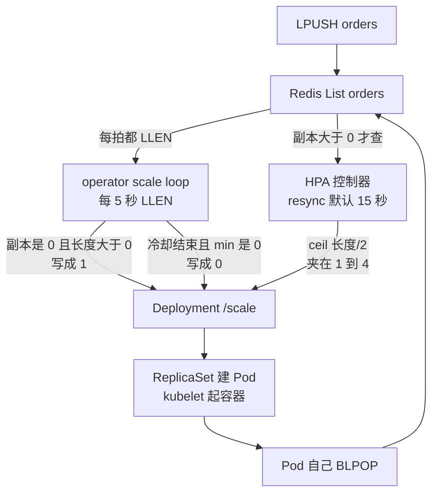
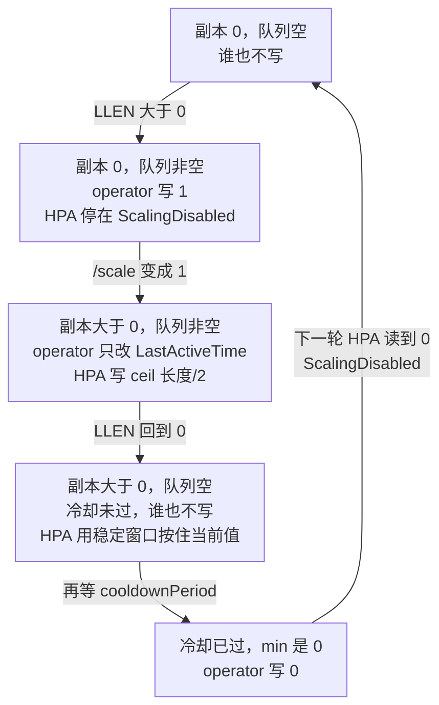
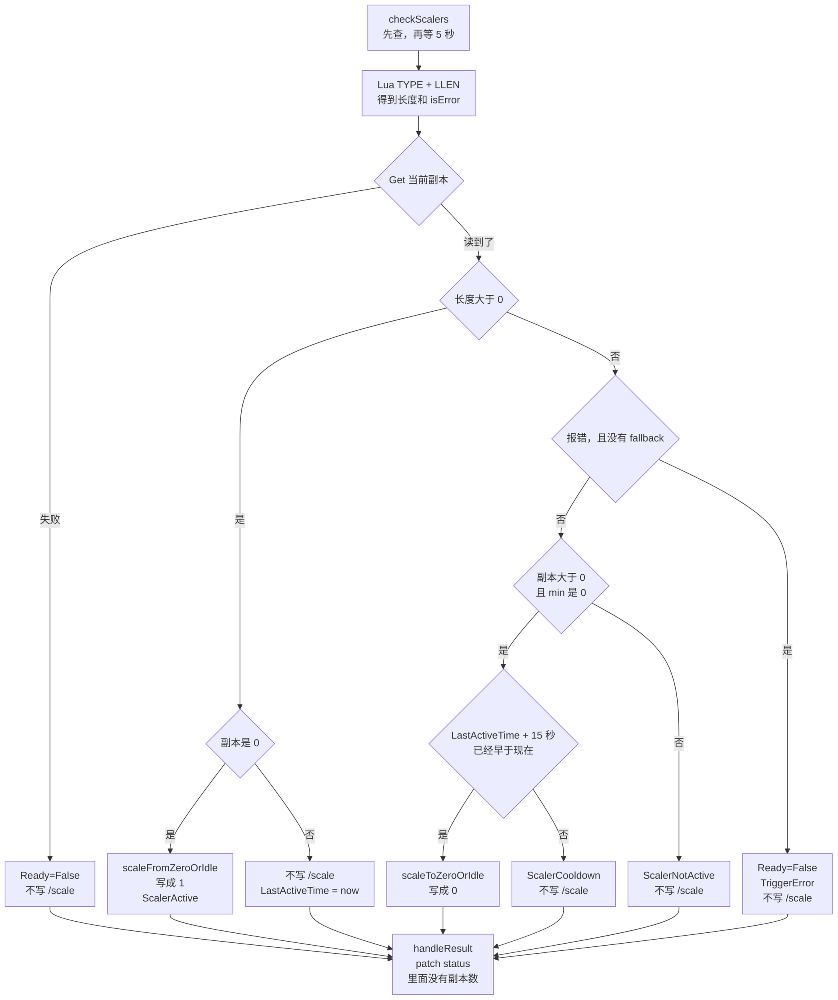
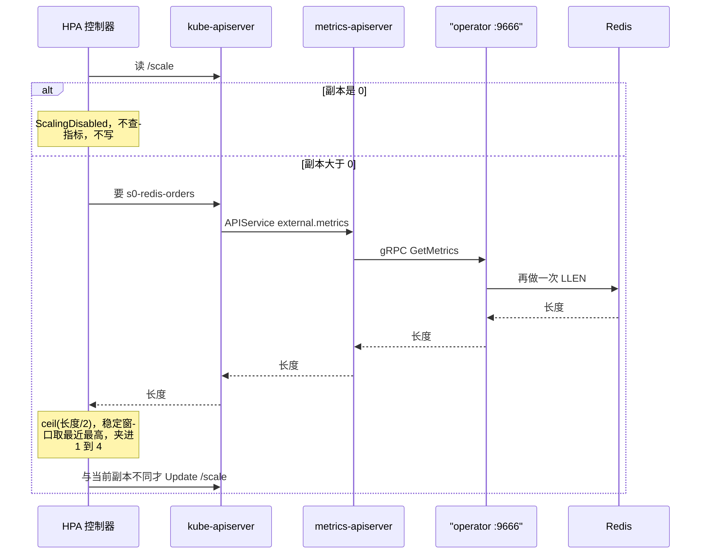
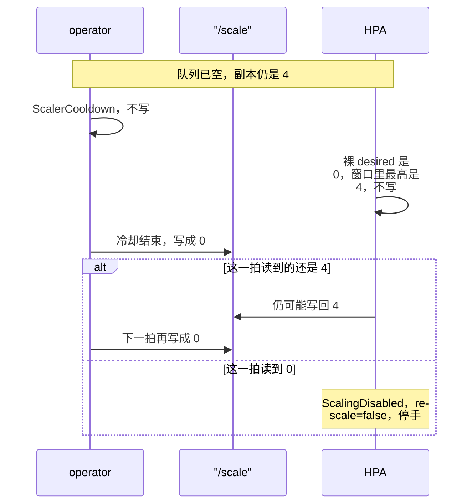
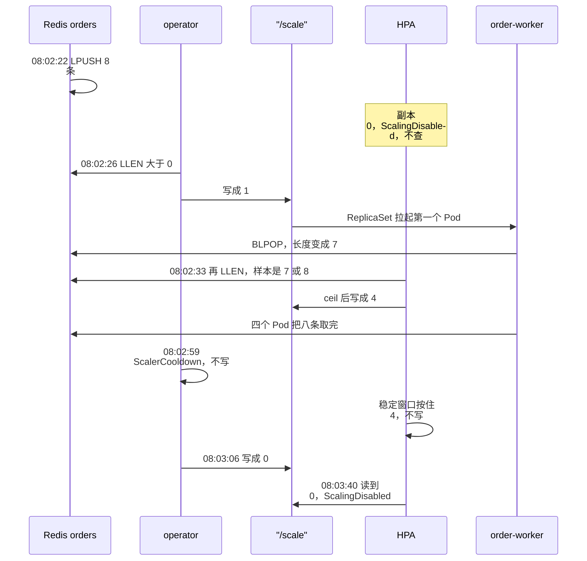

# KEDA 怎样工作

背景：这次没有打开 `HPAScaleToZero`，KEDA 又把 HPA 的 `minReplicas` 固定成 1。副本为 0 时，HPA 不查外部指标，也不改 `/scale`。从 0 拉起、以及写回 0，由 `keda-operator` 完成。1 到 N 仍由 HPA 计算。两边写的是同一个 scale 子资源。

目标：用 Redis List `orders` 上的 8 笔订单，写清 Deployment `order-worker` 的副本每次是谁写的、条件是什么。订单正文不进 KEDA，消费者自己 `BLPOP`。组件关系在第 8 节，安装步骤在 [README](./README.md)。

2026-10-10 08:02:22（+0800）起的 44 秒里，`/scale` 被改了三次：operator 把 0 写成 1，HPA 把 1 写成 4，operator 再把 4 写成 0。

对照 KEDA `v2.21.0`（`626ded5d783`）和 Kubernetes `f322464da46`。集群是 kind `k8s-lab`，服务端 v1.36.1。

## 目录

1. [谁写副本](#1-谁写副本)
2. [一次轮询的分支](#2-一次轮询的分支)
3. [越过 0：operator 写 1](#3-越过-0operator-写-1)
4. [1 到 N：HPA 再写同一个 scale](#4-1-到-nhpa-再写同一个-scale)
5. [回到 0：冷却、稳定窗口、HPA 停手](#5-回到-0冷却稳定窗口hpa-停手)
6. [这 8 笔订单](#6-这-8-笔订单)
7. [轮询开始之前](#7-轮询开始之前)
8. [三个进程](#8-三个进程)
9. [边界](#9-边界)
10. [源码索引](#10-源码索引)
11. [观察命令](#11-观察命令)

## 1. 谁写副本

| 段 | 进程 | 周期 | 这次它干什么 |
|---|---|---|---|
| 事件源 | Redis 容器 `keda-redis` | 无 | List `orders`。KEDA 只读长度 |
| 0 的边界 | `keda-operator` 的 scale loop | `pollingInterval`，这次 5 秒 | `LLEN`。副本是 0 且队列非空就写成 1。冷却结束后写成 0 |
| 1 到 N | HPA 控制器 | 自己的队列，默认同步 15 秒 | 副本已经大于 0 时，按外部指标再写同一个 `/scale` |
| 工作负载 | Deployment / ReplicaSet / kubelet | 对象变化时 | 把 `/scale` 上的数字变成 Pod。Pod 自己 `BLPOP` |



reconcile 由 `ScaledObject` 的变化驱动。它创建 HPA、写入 finalizer、拉起 scale loop。它不轮询 Redis，也不在热路径上改副本。第 7 节写它。

`GetHPAMinReplicas` 在 `minReplicaCount` 未设置或小于等于 0 时返回 1。这次 HPA spec 是 min 1、max 4。副本已经是 0 时，HPA 把 `ScalingActive` 标成 False，reason `ScalingDisabled`，`rescale` 为 false，并且不查指标。

这次 `minReplicaCount` 是 0，所以 `IsPollingIntervalRelevant` 为真，`UsesHPAObservations` 为假。scale loop 和 HPA 各自 `LLEN`。只有 min 大于 0、没有 `idleReplicaCount`、trigger 也没开 `useCachedMetrics` 时，scale loop 才改读 HPA 留下的记录。



`type: redis` 的 scaler 跑在 operator 进程里。它不是集群外的 gRPC 服务。

## 2. 一次轮询的分支

`HandleScalableObject` 取消同 key 的旧 loop，再启动 `startPushScalers` 和 `startScaleLoop`。Redis list 不是 `PushScaler`。`PushScaler` 可以在激活时直接调用 `RequestScale`，失活仍走轮询。这次只有轮询。

`startScaleLoop` 先执行 `checkScalers`，再等待 `pollingInterval`。第一拍不等待。

`checkScalers` 的顺序：

1. 按名字重新读取 ScaledObject。读失败则本拍结束。
2. `getScaledObjectState` 为每个 scaler 起一个 goroutine。任一 scaler 的 `IsActive` 为真，对象就是活跃的。任一 scaler 报错，`isError` 为 true，并清掉 scaler 缓存。下一拍重新建客户端。
3. `RequestScale` 读取当前副本，再决定是否写 `/scale`。
4. `handleResult` 把条件和 `LastActiveTime` patch 到 status。这次 patch 不含副本数。
5. 本拍拿到的指标写入 operator 的内存缓存。`useCachedMetrics` 未开启时，HPA 不读这份缓存。

Redis 的 `GetMetricsAndActivity`：

```go
metric := GenerateMetricInMili(metricName, float64(listLen))
return []external_metrics.ExternalMetricValue{metric}, listLen > s.metadata.ActivationListLength, nil
```

长度来自 Lua：先 `TYPE`。list 或不存在走 `LLEN`，zset、set、hash 分别走 `ZCARD`、`SCARD`、`HLEN`。`orders` 是 list。`activationListLength` 这次是 0，比较是严格大于，长度至少为 1 才活跃。长度 0 是不活跃，不是错误。

指标名是 `s<下标>-redis-<listName>`，这次是 `s0-redis-orders`。未写 `metricType` 时用 `AverageValue`。`Utilization` 会被拒绝。`listLength: "2"` 写成 HPA 的 `averageValue: "2"`。

下面是这次单个 Redis trigger 走得到的分支。源码在 `pkg/scaling/executor/scale_scaledobjects.go`。



图上「写成 1」只在 `minReplicaCount` 小于等于 0 时成立。min 大于 0 时，`scaleFromZeroOrIdle` 写这个最小值。

冷却比较的是 `LastActiveTime + cooldownPeriod` 早于现在。`LastActiveTime` 为空时，改用对象创建时间加 `initialCooldownPeriod`。这次分别是 15 秒和 0。源码默认是 300 秒和 0。报错且没有 fallback 时不改副本，Ready 为 False，reason 是 `TriggerError`。

`updateScaleOnScaleTarget` 对 scale 子资源做 Get，把 `spec.replicas` 设成目标，再 Update。Deployment 的 `spec.replicas` 就是这个字段。Update 返回后，Deployment 控制器改 ReplicaSet，ReplicaSet 控制器建或删 Pod。

每一拍最后 `checkHPAHealth` 读取 HPA 的 `ScalingActive`，不改 Ready：

- 条件为 True：`HPAActive=True`。
- reason 是 `ScalingDisabled`：仍然 `HPAActive=True`。这是副本已被收到 0 之后的空闲。
- 其他 False：`HPAActive=False`，reason 原样留下，例如 `FailedGetExternalMetric`。
- 还读不到 HPA：本拍不改 `HPAActive`。

因此空队列时可以同时是 `Ready=True`、`Active=False`、`HPAActive=True` reason `ScalingDisabled`。

## 3. 越过 0：operator 写 1

08:02:22 队列长度是 8，Deployment 仍是 0。HPA 读到 `currentReplicas == 0`，`minReplicas` 是 1。`shouldComputeMetricsForZeroReplicas` 返回不算指标，并禁用扩缩容。条件文案：

```text
scaling is disabled since the replica count of the target is zero
```

`TARGETS` 显示 `<unknown>/2 (avg)`。分母 2 来自 spec，分子没有查询。

08:02:26（UTC 00:02:26）scale loop 看到活跃且副本为 0，进入 `scaleFromZeroOrIdle`。写入个数不看队列长度，这次写 1。

```text
Successfully updated ScaleTarget
Original Replicas Count 0
New Replicas Count 1
```

事件 `KEDAScaleTargetActivated`：`Scaled apps/v1.Deployment keda-redis-demo/order-worker from 0 to 1, triggered by s0-redis-orders`。

ReplicaSet `order-worker-7b4f879c9c` 从 0 扩到 1。Pod `order-worker-7b4f879c9c-m22d4` 绑到 `k8s-lab-worker`。节点上已有镜像 `redis:7-alpine`。08:02:28 该 Pod 就绪，长度为 7。副本离开 0 之后，活跃拍只更新 `LastActiveTime`。

## 4. 1 到 N：HPA 再写同一个 scale

HPA 不 watch 这个 Deployment，只 watch HPA 对象自己。informer 的 resync 默认 15 秒，status 写回后还会再入队。08:02:26 到 08:02:33 相隔 7 秒，是这次入队落点，不是 operator 发出的通知。

副本已经是 1，不再进入 `ScalingDisabled`。查询的指标是 `s0-redis-orders`，标签 `scaledobject.keda.sh/name=order-worker`。



metrics-apiserver 不连接 Redis。gRPC 只在 leader 上监听，地址是 `keda-operator.keda.svc.cluster.local:9666`。`GetScaledObjectMetrics` 再次调用 `GetMetricsAndActivity`。

指标类型是 `AverageValue`，计算函数是 `GetExternalPerPodMetricReplicas`。两边都取 Quantity 的 `MilliValue`：长度 8 收成 `8.000`，MilliValue 是 8000；目标 `2` 的 MilliValue 是 2000。相除后毫单位消掉。

```text
usageRatio = 队列长度 / (listLength * 当前副本)
落在容差外时，desired = ceil(队列长度 / listLength)
```

容差默认 0.1。`behavior` 为空时，`normalizeDesiredReplicas` 先在 5 分钟窗口里取最近最高的建议，再用 `convertDesiredReplicasWithRules` 夹在 1 和 4 之间。单次扩容上限是 `max(2 × 当前副本, 4)`。从 1 扩起，这道上限是 4，与 `maxReplicas` 相同。

08:02:33 的事件：

```text
SuccessfulRescale
New size: 4; reason: external metric s0-redis-orders(&LabelSelector{MatchLabels:map[string]string{scaledobject.keda.sh/name: order-worker,},MatchExpressions:[]LabelSelectorRequirement{},}) above target
```

事件里没有指标原值。`ceil(7/2)` 和 `ceil(8/2)` 等于 4，`ceil(4/2)` 等于 2。08:02:28 的长度是 7。08:02:33 四个 Pod 就绪时长度已经是 4，那是新 Pod `BLPOP` 之后的数。按长度 7、副本 1 计算，`usageRatio` 是 3.5，超出容差。

同一个 ReplicaSet 从 1 扩到 4。另外三个 Pod 是 `dcx9r`、`ksgf9`、`xhzq8`，都在 `k8s-lab-worker`。

## 5. 回到 0：冷却、稳定窗口、HPA 停手

四个 Pod 继续 `BLPOP`。清单里每次处理 `sleep 20`，让 HPA 采样时队列仍非空。KEDA 下一拍只看 `LLEN`。



冷却从最近一次活跃起算，不是从 08:02:26 写成 1 起算。副本大于 0 且本拍仍活跃时，只更新 `LastActiveTime`。变为不活跃后再等 15 秒。08:02:59 副本仍是 4、长度是 0，status 为 `ScalerCooldown`。08:03:06 才写 0。这两次观察之间没有记录每一拍的 `LastActiveTime`。

HPA 采到长度 0 时，裸 desired 是 `ceil(0/2)=0`。`stabilizeRecommendation` 在默认 5 分钟内保留最高建议 4。条件是 `ScaleDownStabilized`，文案是 `recent recommendations were higher than current one, applying the highest recent recommendation`。窗口结束后，`minReplicas` 仍是 1，小于 1 的建议会被夹成 1，reason `TooFewReplicas`。这次没有等到那 5 分钟。

08:03:06（UTC 00:03:06）的日志：

```text
Successfully set ScaleTarget replicas count to ScaledObject minReplicaCount
Original Replicas Count 4
New Replicas Count 0
```

事件 `KEDAScaleTargetDeactivated`：`Deactivated apps/v1.Deployment keda-redis-demo/order-worker from 4 to 0`。ReplicaSet 收到 0。kubelet 向四个 Pod 发出 `Killing`。正在睡眠的进程收到 `SIGTERM`。

08:03:40 观察到 `REPLICAS` 0，`TARGETS` 为 `<unknown>/2 (avg)`，`ScalingActive=False` reason `ScalingDisabled`。上图中「这一拍读到的还是 4」这次没有发生。

## 6. 这 8 笔订单

没有 selector 的 Service 把 `redis.keda-redis-demo.svc.cluster.local:6379` 指到 kind 网络上的 `172.20.0.4`。

| 字段 | 这次 | 默认 | 在哪一拍起作用 |
|---|---|---|---|
| `minReplicaCount` | 0 | 未设置也按 0 | 允许写 0，同时把 HPA min 固定成 1 |
| `maxReplicaCount` | 4 | — | 只进入 HPA max。从 1 扩容时，单次上限也是 4 |
| `listLength` | `"2"` | — | 只进入 HPA 的 `averageValue`。从 0 拉起时不用它 |
| `activationListLength` | `"0"` | — | `listLen > 0` 才算活跃 |
| `pollingInterval` | 5 秒 | 30 秒 | scale loop 的周期。第一拍不等 |
| `cooldownPeriod` | 15 秒 | 300 秒 | 最近一次活跃之后多久才允许写 0 |
| `initialCooldownPeriod` | 0 | 0 | 还没有 `LastActiveTime` 时使用 |

时刻是 +0800。



八条都被取走，每个 Pod 两条。结束后仍是空闲：Deployment `0/0`，`LLEN orders` 为 0，ScaledObject 为 `Ready=True`、`Active=False`（`ScalerNotActive`）、`Fallback=False`、`Paused=False`、`HPAActive=True` reason `ScalingDisabled`。

Service 刚创建时，EndpointSlice 已经存在，kube-proxy 规则还没装上。operator 日志是 `failed to dial after 5 attempts: dial tcp 10.96.206.94:6379: connect: connection refused`。这走第 2 节的错误分支：不改副本，Ready 为 `TriggerError`。下一轮 `PING` 和 `LLEN` 成功。空队列是 `ScalerNotActive`，不是这条错误。

## 7. 轮询开始之前

`kubectl apply` 先经过 webhook `vscaledobject.kb.io`，对象再写入 etcd。`Reconcile` 不看队列长度。08:00:15（UTC 00:00:15）做完下面几步，scale loop 才开始跑：

1. 加上 finalizer `finalizer.keda.sh`。日志是 `Adding Finalizer for the ScaledObject`，随后是 `prefer a domain-qualified finalizer name including a path (/)`。对象上的名字仍然不带 `/`。只有 `advanced.restoreToOriginalReplicaCount: true` 时，删除对象才会把副本写回 `status.originalReplicaCount`。这次没开。
2. 补上标签 `scaledobject.keda.sh/name=order-worker`。Metrics Adapter 用它把 HPA 查询对上这个对象。
3. 确认 Deployment 有 `/scale`。日志是 `Detected resource targeted for scaling`，资源 `apps/v1.Deployment`，名字 `order-worker`。
4. 创建 HPA `keda-hpa-order-worker`。默认名是 `keda-hpa-` 加上 ScaledObject 的名字。ownerReference 指向该 ScaledObject，`controller: true`。
5. HPA 是新建的，于是 `requestScaleLoop`。事件是 `Scaler redis is built` 和 `Started scalers watch`。

| 字段 | 值 | 来源 |
|---|---|---|
| `scaleTargetRef` | `apps/v1` Deployment `order-worker` | `scaleTargetRef` |
| `minReplicas` | 1 | `GetHPAMinReplicas`。ScaledObject 的 0 映射成 1 |
| `maxReplicas` | 4 | `maxReplicaCount` |
| 指标 | External `s0-redis-orders`，`AverageValue` `2` | trigger 下标 0，`listLength` |
| 选择器 | `scaledobject.keda.sh/name=order-worker` | 上面的标签 |
| `behavior` | 空 | Kubernetes 默认。同步 15 秒，缩容稳定窗口 5 分钟，容差 0.1，单次扩容上限 `max(2 × 当前副本, 4)` |

`autoscaling.keda.sh/paused` 或 `paused-replicas` 会停掉 scale loop 并删除 HPA。`paused-scale-in` 和 `paused-scale-out` 只把对应方向的 `selectPolicy` 设成 Disabled，loop 继续。这次缩到 0 没有这些注解。

## 8. 三个进程


`keda-operator` 做 reconcile、scale loop 和 Redis scaler，并在 `:9666` 提供 gRPC。`keda-operator-metrics-apiserver` 把外部指标查询转成对 leader 的 gRPC，不连接 Redis。`keda-admission-webhooks` 在对象写入 etcd 之前校验 ScaledObject。消费者 Pod 不在这条调用链上。

Lease `operator.keda.sh` 在命名空间 `keda`，由 operator 的 leader 持有。APIService `v1beta1.external.metrics.k8s.io` 的 Available 为 True，后端是 metrics-apiserver。

ValidatingWebhookConfiguration `keda-admission` 上有 `vscaledobject.kb.io`、`vscaledjob.kb.io`、`vstriggerauthentication.kb.io`、`vsclustertriggerauthentication.kb.io`、`vcloudeventsource.kb.io`、`vclustercloudeventsource.kb.io`。这次只用第一个。

CRD 有 `scaledobjects.keda.sh`、`scaledjobs.keda.sh`、`triggerauthentications.keda.sh`、`clustertriggerauthentications.keda.sh`、`cloudeventsources.eventing.keda.sh`、`clustercloudeventsources.eventing.keda.sh`。这次只有 ScaledObject `order-worker`。

## 9. 边界

`ScaledJob` 按事件创建 Job，不把一个长期 Deployment 交给 HPA。scale loop 对它调用 `RequestJobScale`，不创建 HPA。这次没有 ScaledJob。

外置 scaler 是另一种 trigger：独立进程用 gRPC 把指标交给 operator。`type: redis` 的客户端在 operator 进程内。

只有 CPU 或内存 trigger、且没有错误时，`getScaledObjectState` 把 `isActive` 强制为 true。副本为 0 时没有用量，否则无法从 0 拉起。这次只有 Redis，不走这句。

没有配置 Fallback 时，scaler 报错只把 Ready 标成 False，副本留在原地。这次的空队列是 `LLEN` 为 0，不是报错。

HTTP add-on 没有安装。这次没有按 HTTP 请求把流量转进 Pod 的数据面。订单先进入 Redis，KEDA 只看见长度。

## 10. 源码索引

KEDA 文件相对于 tag `v2.21.0`。HPA 的三行来自 Kubernetes 提交 `f322464da46`。

| 位置 | 作用 |
|---|---|
| `pkg/scaling/scale_handler.go` | `startScaleLoop` 先查再等；`checkScalers`；`getScaledObjectState`；`handleResult` 只 patch status |
| `pkg/scaling/executor/scale_scaledobjects.go` | `RequestScale` 的分支；`scaleFromZeroOrIdle` 写 1；`scaleToZeroOrIdle` 冷却后写 0；`updateScaleOnScaleTarget`；`getHPAHealth` |
| `pkg/scaling/executor/scale_executor.go` | 默认冷却 300 秒，首次冷却 0 |
| `pkg/scalers/redis_scaler.go` | Lua；`listLen > activationListLength` |
| `pkg/scalers/scaler.go` | 默认 `AverageValue`；指标名 `s%d-%s`；`GenerateMetricInMili` 把长度收成三位小数量 |
| `controllers/keda/scaledobject_controller.go` | `Reconcile`。暂停时停 loop 并删 HPA |
| `controllers/keda/hpa.go` | `newHPAForScaledObject`；默认名 `keda-hpa-<name>` |
| `controllers/keda/scaledobject_finalizer.go` | `finalizer.keda.sh`。只有打开 restore 才写回原副本 |
| `apis/keda/v1alpha1/scaledobject_types.go` | `GetHPAMinReplicas`；`IsPollingIntervalRelevant`；`UsesHPAObservations` |
| `pkg/metricsservice/server.go` | gRPC `GetMetrics`，只在 leader 上启动 |
| `pkg/provider/provider.go` | HPA 查询转成 gRPC。选择器是 `scaledobject.keda.sh/name` |
| `pkg/controller/podautoscaler/horizontal.go` | 副本为 0 时 `ScalingDisabled` 且不算指标；`stabilizeRecommendation`；`convertDesiredReplicasWithRules` |
| `pkg/controller/podautoscaler/replica_calculator.go` | `GetExternalPerPodMetricReplicas`，`ceil(usage / targetPerPod)` |
| `pkg/controller/podautoscaler/config/v1alpha1/defaults.go` | 同步周期 15 秒，缩容稳定窗口 5 分钟，容差 0.1 |

## 11. 观察命令

```bash
kubectl --context kind-k8s-lab -n keda-redis-demo describe scaledobject order-worker
kubectl --context kind-k8s-lab -n keda-redis-demo describe hpa keda-hpa-order-worker
kubectl --context kind-k8s-lab -n keda logs deploy/keda-operator | rg 'ScaleTarget|Reconciling|Finalizer'
kubectl --context kind-k8s-lab -n keda get lease operator.keda.sh
```

队列长度：

```bash
export DOCKER=/Applications/Docker.app/Contents/Resources/bin/docker
"$DOCKER" exec keda-redis redis-cli LLEN orders
```
